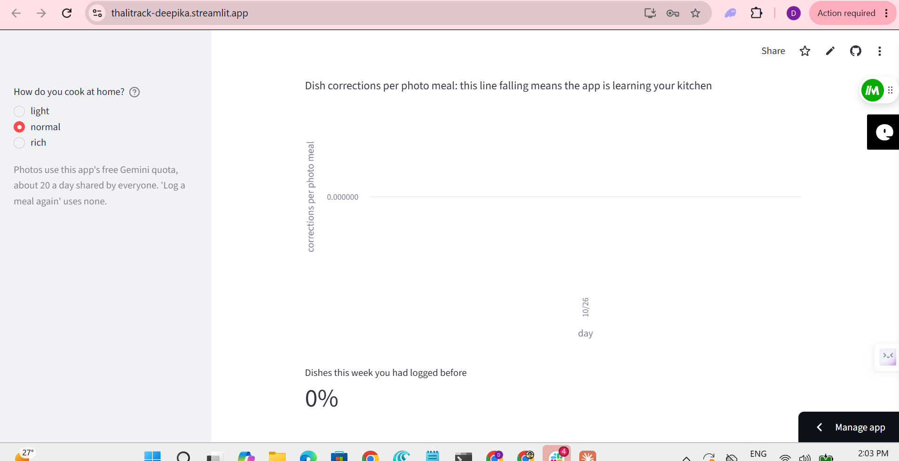

# ThaliTrack

Photograph your thali, confirm the dishes with a tap or two, and track your nutrition.
The app learns your usual dishes, amounts and cooking style from your own meals.

**Live app:** https://thalitrack-deepika.streamlit.app

## How well it works

Benchmark: 15 real thali photos with a reviewed answer key, scored by `eval.py`
against Gemini's recorded answers (no API calls).

| Number | Result |
|---|---|
| Dish recall (look-alikes count half) | 83% |
| Dish precision | 89% |
| Count accuracy (rotis, puris, sweets) | 100% |
| Tokens per photo (hidden thinking included) | 2942 |

From my own photo meals:

| Number | Result |
|---|---|
| Dishes kept as suggested | 100% |
| Corrections per photo meal | 0 on the first day, 0 on the last |

What it missed, and all the numbers, are in `results.json`.

## Built with

Python · Gemini (structured JSON output) · Streamlit · Supabase (Postgres, login,
row-level security) · Streamlit Community Cloud

Photos: Wikimedia Commons, credits in `photos/NOTICE.md`. Nutrition: USDA FoodData
Central, built into Indian dishes (`data/NOTICE.md`). Estimates only, not medical
or dietary advice.